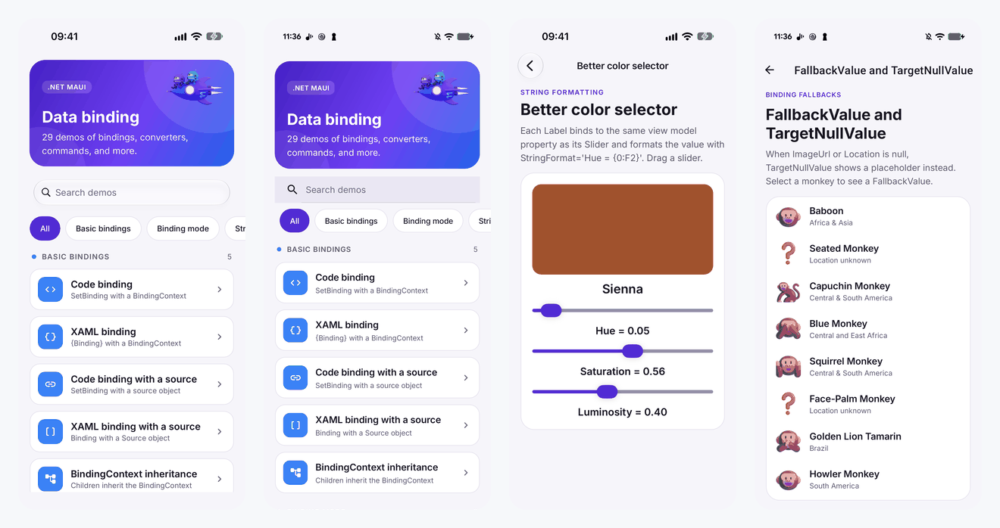
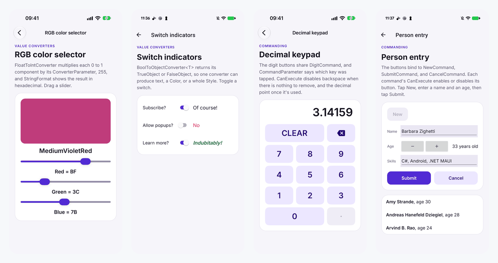

# Data binding

A .NET Multi-platform App UI (.NET MAUI) data binding links a pair of properties between two objects, at least one of which is usually a user-interface object, so that changes in one property are automatically reflected in the other property. These two objects are called the *target* and the *source*:

- The *target* is the object (and property) on which the data binding is set.
- The *source* is the object (and property) referenced by the data binding.

This sample demonstrates the data binding techniques that are available in .NET MAUI: basic bindings, binding modes, string formatting, binding paths, value converters, relative bindings, binding fallbacks, multi-bindings, commanding, and compiled bindings.

The home page groups the demos by topic, and you can search or filter them. Each demo page names the API it uses, then shows the demo in a card, in light and dark themes. The screenshots below follow your GitHub theme.

<picture>
  <source media="(prefers-color-scheme: dark)" srcset="images/home-dark.png">
  <source media="(prefers-color-scheme: light)" srcset="images/home-light.png">
  
</picture>

<picture>
  <source media="(prefers-color-scheme: dark)" srcset="images/demo-pages-dark.png">
  <source media="(prefers-color-scheme: light)" srcset="images/demo-pages-light.png">
  
</picture>

For more information about this sample, see [.NET MAUI data binding](https://learn.microsoft.com/dotnet/maui/fundamentals/data-binding/).

## Styling and assets

All styling lives in resource dictionaries, so each page contains little more than the bindings it demonstrates:

- `Resources/Styles/Colors.xaml` defines the color tokens. Most come in `Light` and `Dark` pairs, plus a shared accent palette.
- `Resources/Styles/Styles.xaml` defines implicit styles that theme every control, and explicit styles such as `Title1`, `Lead`, and `DemoSurface` that pages opt into.
- The app uses the [Inter](https://rsms.me/inter/) typeface (SIL Open Font License) and [Material Icons Round](https://fonts.google.com/icons) (Apache License 2.0). Their license files are in `Resources/Fonts`.
- The monkey images and the question mark shown for missing images are 3D [Fluent Emoji](https://github.com/microsoft/fluentui-emoji) by Microsoft (MIT License), bundled in `Resources/Images/Animals` with their license file, so the sample works offline.
