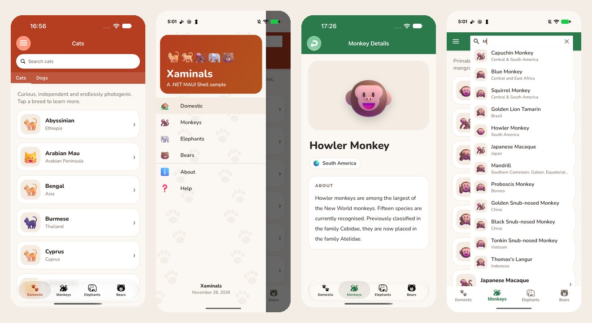

# Shell

.NET Multi-platform App UI (.NET MAUI) Shell reduces the complexity of app development by providing the fundamental features that most apps require, including:

- A single place to describe the visual hierarchy of an app.
- A common navigation user experience.
- A URI-based navigation scheme that permits navigation to any page in the app.
- An integrated search handler.

This sample, Xaminals, is a small animal field guide built with Shell. It demonstrates:

- A flyout with a header, footer, flyout items and a menu item (`AppShell.xaml`, `Controls/FlyoutHeader.xaml`, `Controls/FlyoutFooter.xaml`).
- Bottom tabs, with top tabs for Cats and Dogs in the Domestic tab.
- Per-section Shell colors, set with styles in `AppShell.xaml`.
- Registered routes and navigation that passes a string query parameter (cats and dogs) or an object (monkeys, elephants and bears) to detail pages.
- A `SearchHandler` with templated suggestions on every list page (`Controls/AnimalSearchHandler.cs`).
- A `BackButtonBehavior` with a custom icon and command on the monkey details page.

The screenshots below follow your GitHub theme.

<picture>
  <source media="(prefers-color-scheme: dark)" srcset="images/xaminals-dark.png">
  <source media="(prefers-color-scheme: light)" srcset="images/xaminals-light.png">
  
</picture>

For more information about this sample, see [.NET MAUI Shell](https://learn.microsoft.com/dotnet/maui/fundamentals/shell/).

## Styling and assets

- `Resources/Styles/Colors.xaml` and `Resources/Styles/Styles.xaml` define the colors and styles, in light and dark themes.
- The app uses the [Nunito](https://github.com/googlefonts/nunito) typeface (SIL Open Font License). Its license file is in `Resources/Fonts`.
- The animal images and icons are [Fluent Emoji](https://github.com/microsoft/fluentui-emoji) by Microsoft (MIT License), bundled in `Resources/Images/Emoji` and `Resources/Images/Icons`, so the sample works offline. The license file is in `Resources/Images/Emoji`.
