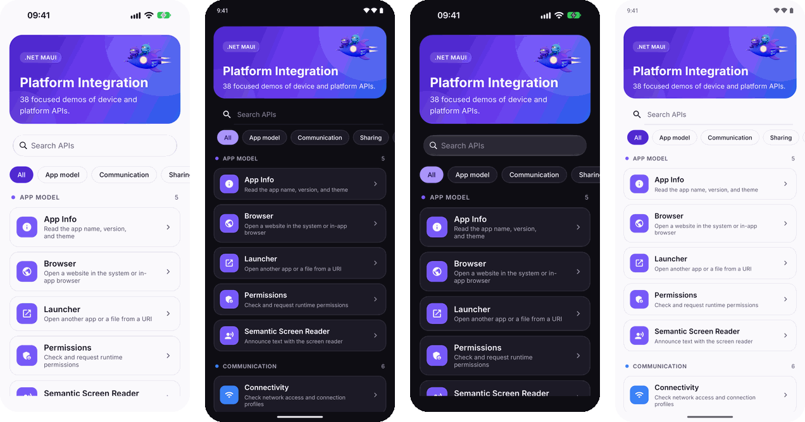
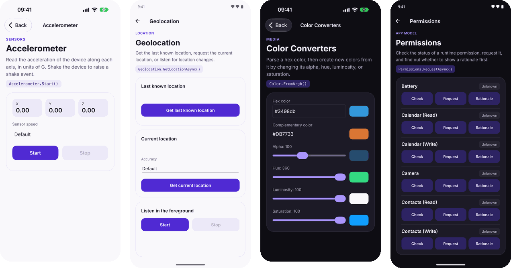

# Platform integration

Each platform that .NET Multi-platform App UI (.NET MAUI) supports offers unique operating system and platform APIs that you can access from C#. .NET MAUI provides cross-platform APIs to access much of this platform functionality, which includes access to sensors, accessing information about the device an app is running on, checking network connectivity, storing data securely, and initiating browser-based authentication flows.

This sample demonstrates the following functionality:

- `Microsoft.Maui.ApplicationModel` namespace:
  - App actions
  - App information
  - Browser
  - Launcher
  - Main thread
  - Maps
  - Permissions
  - Version tracking
- `Microsoft.Maui.ApplicationModel.Communication` namespace:
  - Contacts
  - Email
  - Networking
  - Phone dialer
  - SMS (messaging)
  - Web authenticator
- `Microsoft.Maui.ApplicationModel.DataTransfer` namespace:
  - Clipboard
  - Share files and text
- `Microsoft.Maui.Devices` namespace:
  - Battery
  - Device display
  - Device information
  - Device sensors
  - Flashlight
  - Geocoding
  - Geolocation
  - Haptic feedback
  - Vibration
- `Microsoft.Maui.Media` namespace:
  - Media picker
  - Screenshot
  - Text-to-speech
  - Unit converters
- `Microsoft.Maui.Storage` namespace:
  - File picker
  - File system helpers
  - Preferences
  - Secure storage

The home page groups the demos by category, and you can search or filter them. Each demo page names the API it uses, then shows a card with the controls and the results, in light and dark themes.

Some APIs need real hardware or services. In a simulator or emulator, sensors report zeros, the flashlight and vibration aren't available, and the phone dialer, SMS, and email apps might be missing.

For more information about the sample see [Platform integration](https://learn.microsoft.com/dotnet/maui/platform-integration/).

## Styling

All styling lives in resource dictionaries, so each page contains little more than the API it demonstrates:

- `Resources/Styles/Colors.xaml` and `Resources/Styles/Styles.xaml` define the color tokens and styles shared with the other gallery samples, such as `Title1`, `Lead`, and `DemoSurface`.
- `Resources/Styles/DemoStyles.xaml` adds the styles specific to this sample, such as the API chip and the sensor readouts.
- The app uses the [Inter](https://rsms.me/inter/) typeface (SIL Open Font License) and [Material Icons Round](https://fonts.google.com/icons) (Apache License 2.0). Their license files are in `Resources/Fonts`.
