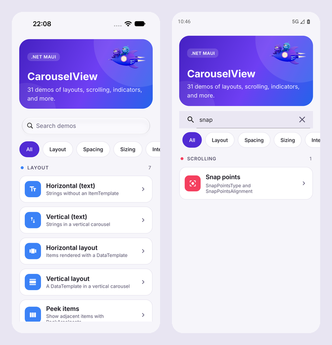
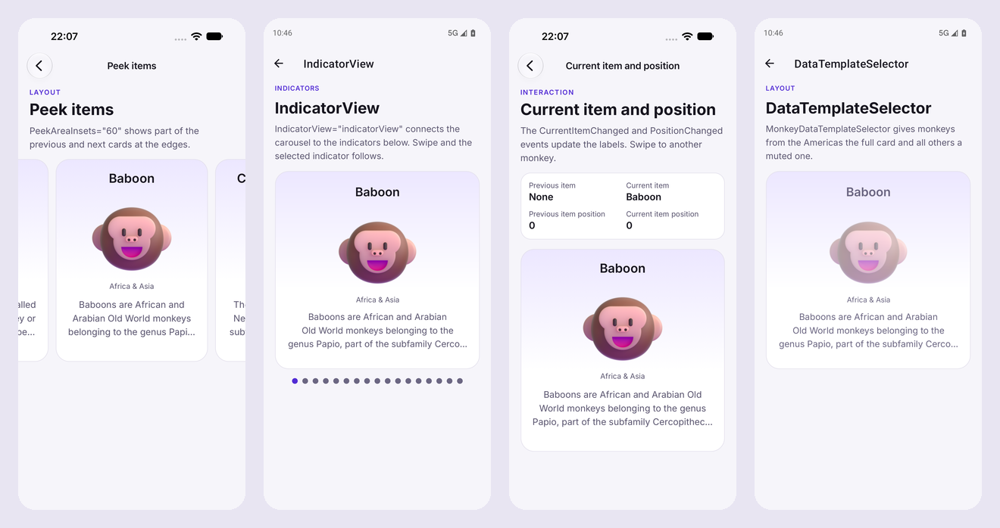

# CarouselView

The .NET Multi-platform App UI (.NET MAUI) `CarouselView` is a view for presenting data in a scrollable layout, where users can swipe to move through a collection of items.

This sample demonstrates how to use the .NET MAUI `CarouselView`: horizontal and vertical layouts, peek areas, spacing, item sizing, the current item and position, visual states, looping, `IndicatorView`, empty views, scrolling and snap points, incremental loading, pull to refresh, and swipe items.

The home page groups the demos by category, and you can search or filter them. Each demo page names the API it uses, then shows the `CarouselView`, in light and dark themes. The screenshots below follow your GitHub theme.

<picture>
  <source media="(prefers-color-scheme: dark)" srcset="images/home-dark.png">
  <source media="(prefers-color-scheme: light)" srcset="images/home-light.png">
  
</picture>

<picture>
  <source media="(prefers-color-scheme: dark)" srcset="images/demo-pages-dark.png">
  <source media="(prefers-color-scheme: light)" srcset="images/demo-pages-light.png">
  
</picture>

For more information about this sample, see [.NET MAUI CarouselView](https://docs.microsoft.com/dotnet/maui/user-interface/controls/carouselview/).

## Styling and assets

All styling lives in resource dictionaries, so each page contains little more than the `CarouselView` it demonstrates:

- `Resources/Styles/Colors.xaml` defines the color tokens. Most come in `Light` and `Dark` pairs, plus a shared accent palette.
- `Resources/Styles/Styles.xaml` defines implicit styles that theme every control, and explicit styles such as `Title1`, `Lead`, `DemoSurface`, and `ItemCard` that pages opt into.
- The app uses the [Inter](https://rsms.me/inter/) typeface (SIL Open Font License) and [Material Icons Round](https://fonts.google.com/icons) (Apache License 2.0). Their license files are in `Resources/Fonts`.
- The animal images are 3D [Fluent Emoji](https://github.com/microsoft/fluentui-emoji) by Microsoft (MIT License), bundled in `Resources/Images/Animals` with their license file, so the sample works offline.

Pages are under [CarouselViewDemos/Views](CarouselViewDemos/Views).
