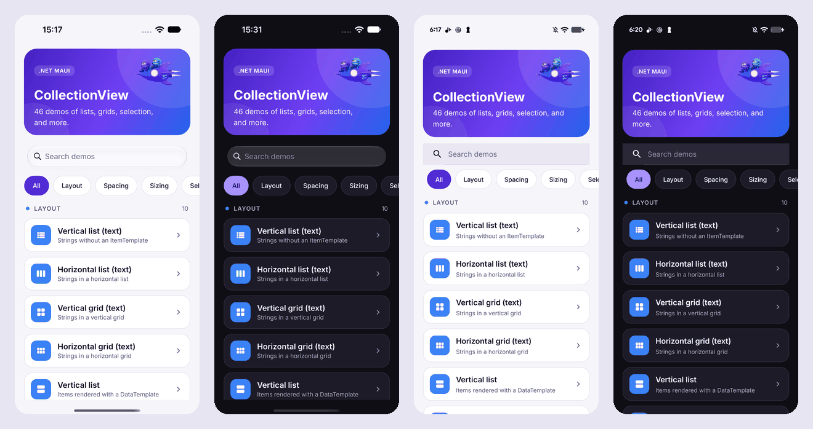
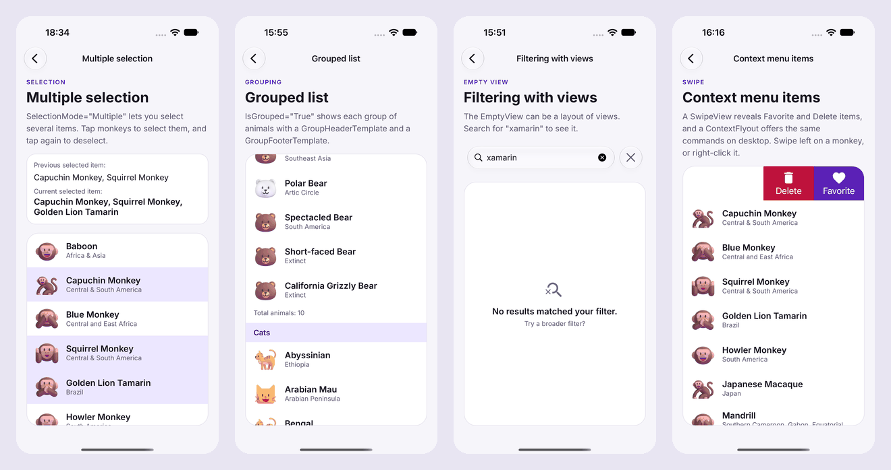

# CollectionView

The .NET Multi-platform App UI (.NET MAUI) `CollectionView` is a view for presenting lists of data using different layout specifications. It aims to provide a more flexible, and performant alternative to `ListView`.

This sample demonstrates how to use the .NET MAUI `CollectionView`: layouts, spacing, item sizing, selection, empty views, grouping, pull to refresh, headers and footers, scrolling, and swipe actions.

The home page groups the demos by category, and you can search or filter them. Each demo page names the API it uses, then shows the `CollectionView` in a card, in light and dark themes.

For more information about this sample, see [.NET MAUI CollectionView](https://docs.microsoft.com/dotnet/maui/user-interface/controls/collectionview/).

## Styling and assets

All styling lives in resource dictionaries, so each page contains little more than the `CollectionView` it demonstrates:

- `Resources/Styles/Colors.xaml` defines the color tokens. Most come in `Light` and `Dark` pairs, plus a shared accent palette.
- `Resources/Styles/Styles.xaml` defines implicit styles that theme every control, and explicit styles such as `Title1`, `Lead`, `ListSurface`, and `GroupHeader` that pages opt into.
- The app uses the [Inter](https://rsms.me/inter/) typeface (SIL Open Font License) and [Material Icons Round](https://fonts.google.com/icons) (Apache License 2.0). Their license files are in `Resources/Fonts`.
- The animal images are 3D [Fluent Emoji](https://github.com/microsoft/fluentui-emoji) by Microsoft (MIT License), bundled in `Resources/Images/Animals` with their license file, so the sample works offline.

## Coming from ListViewDemos

`ListView` is deprecated in .NET MAUI, so the .NET 11 samples no longer include ListViewDemos. This sample covers the same scenarios with `CollectionView`. The original sample remains in [10.0/UserInterface/Views/ListViewDemos](../../../../10.0/UserInterface/Views/ListViewDemos) for reference.

| ListViewDemos page | CollectionViewDemos equivalent |
|---|---|
| TextListPage | Layout/VerticalListTextPage |
| VerticalListPage | Layout/VerticalListPage |
| DataTemplateSelectorPage | Layout/VerticalListDataTemplateSelectorPage |
| SelectionPage | Selection/VerticalListSingleSelectionPage and the other Selection pages |
| RuntimeItemSizingPage (`ViewCell.ForceUpdateSize`) | Sizing/VerticalListDynamicSizeItemsPage |
| GroupingPage | Grouping/VerticalListGroupingPage |
| ContextMenuItemsPage (`ViewCell.ContextActions`) | Swipe/VerticalListSwipeContextItemsPage: `SwipeView` on touch platforms, `FlyoutBase.ContextFlyout` for right-click on Mac Catalyst and Windows |
| PullToRefreshPage | PullToRefresh/VerticalListPullToRefreshPage (`RefreshView`) |
| RightToLeftListPage | Layout/VerticalListRTLPage |
| ScrollByItemPage | Scrolling/ScrollToByObjectPage |
| ScrollByItemWithGroupingPage | Scrolling/ScrollToByObjectWithGroupingPage |
| TextHeaderFooterPage | HeadersAndFooters/VerticalListHeaderFooterStringPage |
| ViewHeaderFooterPage | HeadersAndFooters/VerticalListHeaderFooterViewPage |
| TemplatedHeaderFooterPage | HeadersAndFooters/VerticalListHeaderFooterDataTemplatePage |

Pages are under [CollectionViewDemos/Views](CollectionViewDemos/Views).
