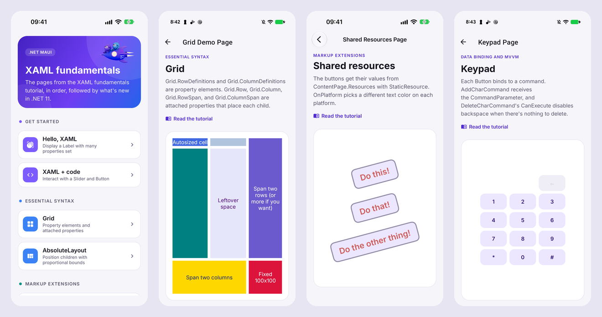
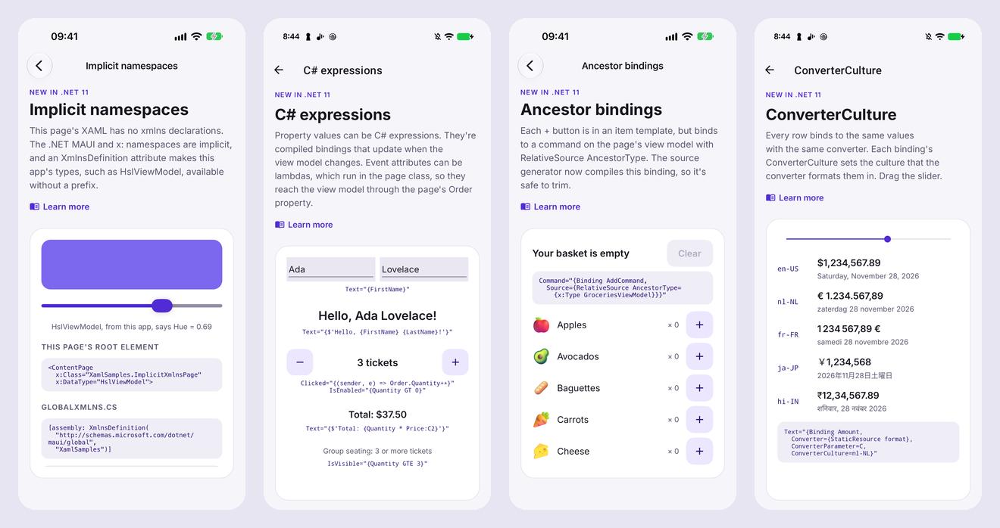

# XAML fundamentals

XAML allows you to define user interfaces in .NET Multi-platform App UI (.NET MAUI) apps using markup rather than code. XAML is never required in a .NET MAUI app, but it's often the preferred and a more succinct approach to building a UI than equivalent code. XAML is particularly well suited for use with the popular MVVM (Model-View-ViewModel) app architecture: XAML defines the View that is linked to ViewModel code through XAML-based data bindings.

This sample contains the pages from the [XAML fundamentals](https://learn.microsoft.com/dotnet/maui/xaml/fundamentals/get-started) tutorial, grouped by the part of the tutorial that explains them:

- **Get started**: properties as attributes, and event handlers in code-behind.
- **Essential syntax**: property elements and attached properties, with `Grid` and `AbsoluteLayout`.
- **Markup extensions**: `StaticResource`, `OnPlatform`, and `x:Static`.
- **Data binding basics**: `x:Reference`, binding modes, and a `CollectionView` with a value converter.
- **Data binding and MVVM**: view models, `INotifyPropertyChanged`, and commands.

A **New in .NET 11** section adds pages for implicit XAML namespace declarations, C# expressions in XAML, compiled `RelativeSource` ancestor bindings in data templates, and `ConverterCulture`.

The screenshots below follow your GitHub theme.

<picture>
  <source media="(prefers-color-scheme: dark)" srcset="images/tutorial-pages-dark.png">
  <source media="(prefers-color-scheme: light)" srcset="images/tutorial-pages-light.png">
  
</picture>

<picture>
  <source media="(prefers-color-scheme: dark)" srcset="images/dotnet-11-pages-dark.png">
  <source media="(prefers-color-scheme: light)" srcset="images/dotnet-11-pages-light.png">
  
</picture>

## Styling and assets

Each tutorial page contains the XAML that the tutorial teaches, so you can compare them line by line. The styling lives in resource dictionaries instead:

- `Resources/Styles/DemoPage.xaml` gives every page a control template with a header and a card around the page's content. It also adds spacing and theme colors with implicit styles.
- `Resources/Styles/Colors.xaml` and `Resources/Styles/Styles.xaml` define the color tokens and the styles that theme every control in light and dark themes.
- The app uses the [Inter](https://rsms.me/inter/) typeface (SIL Open Font License) and [Material Icons Round](https://fonts.google.com/icons) (Apache License 2.0). Their license files are in `Resources/Fonts`.
- The grocery images are 3D [Fluent Emoji](https://github.com/microsoft/fluentui-emoji) by Microsoft (MIT License), bundled in `Resources/Images/Groceries` with their license file.
